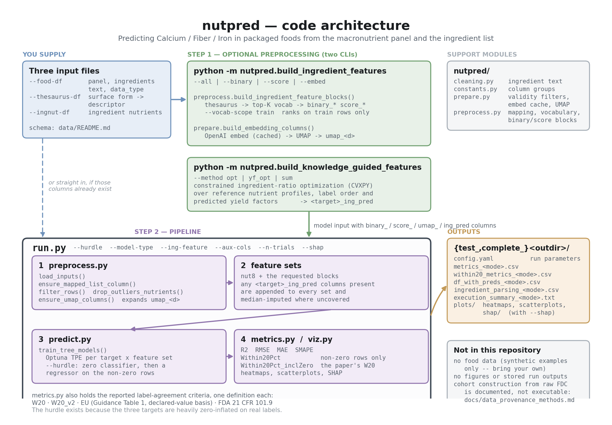

# nutpred: Predicting Calcium, Fiber, and Iron Content of Packaged Foods from Ingredient Lists and Macronutrient Panels

This repository contains the analysis code accompanying:

> [Author names]. "[Paper title]." *Journal of Food Composition and Analysis*, [year]. [DOI once assigned]

## Summary

Calcium, fiber, and iron content are among the more commonly missing or unreliable fields on packaged-food nutrition labels. This codebase predicts these three micronutrients from information that is reliably present on a label -- the macronutrient panel and the ingredient list -- using:

1. the eight base macronutrients reported on every label (`nut8`),
2. ingredient-presence and positional-rank features derived from the ingredient list (`binary`, `score`),
3. low-dimensional ingredient embeddings (`umap`), and
4. an optional auxiliary feature from a constrained convex optimization (CVXPY) that infers per-ingredient nutrient contributions from a reference ingredient-nutrient table.

Models are gradient-boosted trees (default: XGBoost) trained per target nutrient, optionally as a two-stage "hurdle" model (a zero/non-zero classifier followed by a regressor on non-zero values) to address the substantial zero-inflation in Calcium/Fiber/Iron labeling. Hyperparameters are tuned per feature-set/nutrient via Optuna.

---

## Architecture



Two entry points. `python -m nutpred.build_ingredient_features` turns raw
ingredient text into the `binary_` / `score_` / `umap_` feature blocks, and is
only needed if your table does not already carry them. `run.py` then runs the
model. Regenerate the diagram with `python docs/make_architecture_diagram.py`.

---

## Citation

If you use this code, please cite:

```bibtex
@article{[citekey],
  title   = {[Paper title]},
  author  = {[Author names]},
  journal = {Journal of Food Composition and Analysis},
  year    = {[year]},
  doi     = {[DOI]}
}
```

## Data Availability

**No food data is distributed with this repository.** Every entry point takes
its inputs by argument (`--food-df`, `--thesaurus-df`, `--ingnut-df`); nothing
is hard-coded to a path. What ships instead is a generator for a small
synthetic cohort with exactly the expected columns, so the input contract is
documented by example and a smoke test runs on a fresh clone:

```bash
python data/make_example_data.py     # writes data/example/*
```

Those numbers are arbitrary and carry no nutritional meaning. See
[`data/README.md`](data/README.md) for the full column-by-column schema of all
three inputs and for how to rebuild the real ones.

The underlying food records originate from the U.S. Department of Agriculture's
[FoodData Central](https://fdc.nal.usda.gov/) Branded Foods database, which is
public domain and freely downloadable. The analysis uses the snack subset of
that database; you assemble the cohort yourself from the raw CSV exports
(`food.csv`, `branded_food.csv`, `food_nutrient.csv`, `nutrient.csv`) to the
schema in [`data/README.md`](data/README.md). The generic-ingredient nutrient reference
comes from USDA SR Legacy and the ingredient vocabulary from the USDA
Ingredient Thesaurus. [`docs/data_provenance_methods.md`](docs/data_provenance_methods.md)
records exactly which releases were used, when they were retrieved, and how far
the version analysed sits from the nearest archived release.

Two optional feature groups depend on precomputed tables that this repository's
code does not generate, and which are therefore not available here:
- **Fortifier flags** (`--extra-feature-groups fortifier`): ingredient-keyword-matching output.
- **Cluster labels** (`--extra-feature-groups cluster`): externally produced cluster assignments.

Both default to off and the core reported pipeline does not require them. See
[Extra Feature Groups](#extra-feature-groups-fortifier-and-cluster) below.

### Figures and result files

Neither figures nor stored run outputs are distributed. The scripts that
produce the paper's tables are included (see [Paper Tables](#paper-tables))
and regenerate them from a run's prediction files.

---

## Getting Started

### Installation

1. **Clone the Repository**:
   ```bash
   git clone https://github.com/sarahjang15/nutpred.git
   cd nutpred
   ```

2. **Install Dependencies**:
   ```bash
   pip install -r nutpred/requirements.txt
   ```

3. **Prepare Data**:
   Supply your own three inputs by argument. To check the install works first,
   generate the synthetic examples and run against those:

   ```bash
   python data/make_example_data.py
   python run.py --smoke-test-rows 200 \
     --food-df      data/example/food_df.example.csv \
     --thesaurus-df data/example/thesaurus.example.xlsx \
     --ingnut-df    data/example/ingnut_df.example.csv
   ```

   [`data/README.md`](data/README.md) documents every column each input must
   carry, and how to build the real ones from USDA FoodData Central.

### Reproducing the Reported Results

The reported model is a two-stage (hurdle) XGBoost model trained on the combined `nut8+binary+score+umap20` feature set, with the optimization-based `opt_only` auxiliary feature:

```bash
# optional pre-step: the knowledge-guided auxiliary features
python -m nutpred.build_knowledge_guided_features \
  --food-df your_model_input.csv \
  --out-csv your_model_input_kg.csv

python run.py \
  --food-df your_model_input_kg.csv \
  --hurdle \
  --model-type xgboost \
  --ing-feature "binary+score+umap_20" \
  --n-trials 100 \
  --shap
```

All reported results are on the snack subset of Branded Foods; the pipeline
takes whatever cohort you pass in `--food-df` and does not filter by category
itself. This reproduces the reported *methodology* end to end. It is not guaranteed to reproduce bit-identical metric values against the numbers in the paper: those came from a specific cohort assembled from a FoodData Central release that is no longer distributed (see [`docs/data_provenance_methods.md`](docs/data_provenance_methods.md)), and any cohort you rebuild will differ from it by a small margin of barcode-revision bookkeeping in the underlying USDA data -- not a modelling difference.

### Running the Pipeline

1. **Smoke-test Mode (Quick Run)**
  ```bash
  # Debug-subsample to 100 rows for a quick run (>100 recommended)
  python run.py --smoke-test-rows 100

  # Run with custom exclusion parameters
  python run.py --smoke-test-rows 100 --exclude-values "popcorn,pretzel"
  ```

2. **Complete Mode (Full Dataset)**
  ```bash
  # Run complete pipeline (omit --smoke-test-rows)
  python run.py

  # Run with custom parameters
  python run.py --exclude-type ingredients --exclude-values "popcorn,pretzel,pretzels" --cv 5
  ```

3. **Advanced Options**
  ```bash
  # Full example with all options
  python run.py \
    --smoke-test-rows 200 \
    --random-state 42 \
    --exclude-type ingredients \
    --exclude-values "popcorn,pretzel,pretzels" \
    --food-df /path/to/your/model_input.csv \
    --thesaurus-df /path/to/your/thesaurus.xlsx \
    --ingnut-df /path/to/your/ingnut_table.csv \
    --outdir ./my_outputs \
    --cv 3 \
    --model-type xgboost \
    --n-trials 100 \
    --hurdle \
    --zero-threshold-method youden \
    --shap
  ```

---

## Command Line Arguments

| Argument | Default | Description |
|----------|---------|-------------|
| `--smoke-test-rows` | `None` | Debug-subsample row count for a quick run (`None` = complete pipeline on the full dataset). Not the ML train/test split ratio: `run.py` makes its own 80/20 split and writes it to a `SampleType` column. |
| `--random-state` | `42` | Random seed for reproducibility |
| `--exclude-type` | `ingredients` | Exclusion type: `ingredients` or `category` |
| `--exclude-values` | `none` | Comma-separated terms to exclude:<br/>• **`ingredients`**: Deletes rows containing these ingredient names<br/>• **`category`**: Deletes rows containing these category names |
| `--food-df` | `data/example/food_df.example.csv` | Path to the per-food dataset. Default is the synthetic example; supply your own. |
| `--thesaurus-df` | `data/example/thesaurus.example.xlsx` | Path to the ingredient thesaurus. Default is the synthetic example. |
| `--ingnut-df` | `data/example/ingnut_df.example.csv` | Path to the ingredient-nutrient table. Default is the synthetic example. |
| `--outdir` | `./nutpred_outputs` | Output directory |
| `--cv` | `3` | Cross-validation folds used inside each Optuna trial's objective |
| `--model-type` | `xgboost` | ML algorithm family for the FullNut regressor/classifier: `xgboost`, `random_forest`, `hist_gradient_boosting`, `linear`, `support_vector`, `knn`, `mlp`. Hyperparameters are tuned per feature-set/nutrient via Optuna TPE search. |
| `--n-trials` | `100` | Optuna trial budget per classifier/regressor tuning run |
| `--config` | `None` | Optional YAML file overriding Optuna search-space bounds (`n_estimators_min`, `n_estimators_max`, `max_depth_max`) |
| `--ing-feature` | `binary,score,umap_10,umap_20` | Comma-separated ingredient feature groups, each its own `nut8+<group>` comparison set: `binary,score,umap_2,umap_10,umap_20,all`. `+`-join names within one token to combine them into a single feature set instead (e.g. `"binary+score+umap_20"` for the reported `nut8+binary+score+umap20` model). |
| `--aux-cols` | `<target>_ing_pred` | Knowledge-guided columns to append to every feature set, produced by the `build_knowledge_guided_features` pre-step. The run proceeds without them if absent; rows lacking ingredient-reference coverage are median-imputed. |
| `--extra-feature-groups` | `none` | Comma-separated optional groups appended to every feature set: `fortifier`, `cluster` (see [Extra Feature Groups](#extra-feature-groups-fortifier-and-cluster) below) |
| `--hurdle` (alias `--two-stage`) | `False` | Enable zero-classifier + regressor pipeline |
| `--zero-threshold` | `0.5` | Fixed classifier threshold |
| `--zero-threshold-method` | `fixed` | Threshold selection: `fixed`, `youden`, or `f1` |
| `--zero-eps` | `0.0` | Treat values <= this as zero for classification |
| `--pos-log1p` | `False` | Apply log1p to positive values before regression |
| `--no-umap` | `False` | Disable UMAP features even if columns exist |
| `--shap` | `False` | Compute and save SHAP summary/bar/feature-group plots for every trained model (regressor, and classifier when `--hurdle`) |
| `--outlier-method` | `iqr` | Outlier removal method: `none`, `iqr`, or `zscore` |
| `--outlier-iqr-multiplier` | `1.5` | IQR multiplier for outlier removal |
| `--outlier-zscore` | `4.0` | Z-score threshold for outlier removal |

### Extra Feature Groups: fortifier and cluster

`--extra-feature-groups fortifier,cluster` appends precomputed, non-generated reference columns to every feature set:

```bash
python run.py --extra-feature-groups fortifier,cluster --cluster-feature-col cluster
```

- **`fortifier`**: expects at least one column with `fortifier` in its name already present in `--food-df` (merged onto the food table on `fdc_id`).
- **`cluster`**: expects a cluster-label column, named via `--cluster-feature-col` or one of `cluster`/`cluster_id`/`cluster_label`.

**Neither is regenerated by this repo's code** -- the fortifier keyword-matching rules and the clustering method that produced these columns aren't part of the tracked codebase, only the precomputed output columns are. If the required column isn't found, `run.py` raises an error and exits rather than silently training without it.

---

## Features

- **One ML pipeline, tunable model family**
  - `--model-type`: `xgboost`, `random_forest`, `hist_gradient_boosting`, `linear`, `support_vector`, `knn`, `mlp`.
  - Hyperparameters are searched per feature-set/nutrient via Optuna TPE (`--n-trials`, `--config`), not a fixed grid.
  - `--hurdle` enables a two-stage zero-classifier + positive-value regressor per nutrient.
- **The ingredient-nutrient optimizer as an auxiliary feature, not a separate pipeline**
  - Built by the `build_knowledge_guided_features` pre-step (`--method {opt,yf_opt,sum}`): a constrained CVXPY optimization over reference ingredient nutrients, or a plain-sum baseline. It contributes one `<target>_ing_pred` column per target, which `run.py` appends to every feature set.
- **Comparable ML feature sets** (per `--ing-feature`)
  - Default: `nut8`, `nut8+binary`, `nut8+score`, `nut8+umap_10`, `nut8+umap_20` evaluated side by side.
  - `+`-join group names in `--ing-feature` to combine them into one feature set (e.g. `"binary+score+umap_20"` → `nut8+binary+score+umap_20`, the reported model).
  - optionally extended with `fortifier`/`cluster` (`--extra-feature-groups`) and/or the `_ing_pred` columns above.
- **Robust preprocessing**
  - Ingredient string parsing + thesaurus mapping to normalized tokens.
  - Row exclusion (e.g., popcorn/pretzel) to prevent leakage.
  - Top-K ingredient universe → binary & positional score features.
  - Uses **provided** UMAP embeddings; no embedding training inside the pipeline.
- **Clear, diverse metrics to compare models**
  - **R²**, **RMSE**, **MAE**, **MAPE**, **SMAPE**, **Within20Pct**.
  - When `--hurdle` is used, zero-classifier metrics are also reported (Accuracy, Precision, Recall, ROC_AUC).
- **Tidy outputs**
  - Metrics CSV + model-comparison heatmaps (R² / RMSE / SMAPE) per nutrient.
  - Processed dataset with **truth/pred pairs side-by-side**.
  - Optional SHAP summary/bar/feature-group plots (`--shap`).

---

## Repository Structure
```
nutpred/
├── README.md
├── run.py                    # Main pipeline runner
├── pyproject.toml
├── .gitignore
├── nutpred/                  # Python package
│   ├── __init__.py
│   ├── cleaning.py           # robust ingredient text cleaner
│   ├── constants.py          # column names and nutrient groupings
│   ├── metrics.py            # training metrics (r2_manual, SMAPE, Within20Pct)
│   │                         # plus the reported label-agreement criteria
│   │                         # (W20 / W20_v2 / EU / FDA), one definition each
│   ├── preprocess.py         # ingredient text → thesaurus → top-K vocabulary →
│   │                         # binary/score blocks; vocabulary resolution
│   ├── build_knowledge_guided_features.py
│   │                         # CLI: constrained ingredient-ratio optimization
│   │                         #   python -m nutpred.build_knowledge_guided_features
│   │                         #   (--method opt / yf_opt / sum)
│   ├── predict.py            # Optuna-tuned ML training, one- and two-stage
│   ├── prepare.py            # data-file construction: raw FDC -> standardized
│   │                         # frame, validity filters, embedding cache, UMAP
│   ├── build_ingredient_features.py
│   │                         # CLI: binary_/score_/umap_ feature blocks
│   │                         #   python -m nutpred.build_ingredient_features
│   │                         #   (--all / --binary / --score / --embed)
│   ├── viz.py                # heatmaps, scatterplots, and SHAP analysis
│   └── requirements.txt      # Python dependencies
├── data/                     # NO real data. Schema docs + synthetic examples only.
│   ├── README.md             # column-by-column input contract
│   ├── make_example_data.py
│   └── example/
├── docs/
│   └── data_provenance_methods.md   # which USDA releases, retrieved when
├── tests/
├── nutpred_outputs/          # Output dir (default; override with --outdir).
│                             # Run folders are named test_/complete_ + the
│                             # final path component, e.g. test_nutpred_outputs.
└── logs/                     # Log files
    └── nutpred_[timestamp].log
```

---

## What each entry point needs

Every function takes its data as an argument. This is what each one requires,
and what it fails on if the input is missing a column. Column specifications
are in [`data/README.md`](data/README.md).

### Command-line entry points

| Entry point | Requires | Notes |
|---|---|---|
| `run.py` | `--food-df`, `--thesaurus-df`, `--ingnut-df` | `--food-df` must already carry the `umap_<d>` columns unless `--no-umap`. `--ingnut-df` is read for ingredient-vocabulary extraction. The knowledge-guided `_ing_pred` columns are no longer computed here -- build them with the pre-step below. |
| `python -m nutpred.build_ingredient_features --binary --score` | `--in-csv` (needs `ingredients`), `--thesaurus-xlsx` | Add `--vocab-csv` to take the vocabulary from a reference table's `ing` column instead of ranking by frequency. `--vocab-scope train` additionally needs the split column named by `--split-col` (default `data_type`). |
| `python -m nutpred.build_knowledge_guided_features` | `--food-df`, `--thesaurus-df`, `--ingnut-df` | Writes `<target>_ing_pred`. `--method yf_opt` additionally needs `--yf-column`, a column of per-ingredient yield-factor lists. |
| `python -m nutpred.build_ingredient_features --embed` | `--in-csv` (needs `ingredients`) | Calls the OpenAI embeddings API, so `OPENAI_API_KEY` or `--api-key` is needed **on a cache miss only**. A run whose embeddings are already in `data/embedding_cache` needs no key. |

### Library functions

| Function | Requires | Produces |
|---|---|---|
| `prepare.prepare_pipeline(raw_dir)` | a directory holding FoodData Central's `food.csv`, `branded_food.csv`, `food_nutrient.csv`, `nutrient.csv` | one standardized frame: identifiers, `ingredients`, and the prepared nutrient columns, deduplicated to the latest record per `gtin_upc` |
| `prepare.filter_valid_nutrition_data(df)` | the nutrient columns | the frame with implausible rows dropped (rule-based validity checks) |
| `prepare.make_full_df_nona(df)` | the `NUT11` columns | the frame with rows missing any required nutrient dropped |
| `prepare.build_embedding_columns(df, dims=...)` | `ingredients`; an API key only on a cache miss | `umap_<d>` list columns; embeds distinct strings once and caches them |
| `preprocess.build_ingredient_feature_blocks(df, thesaurus)` | `ingredients`; the split column if `vocab_scope="train"` | `mapped_list`, `mapped_list_topk_only`, the `binary_`/`score_` blocks, and an info dict carrying the vocabulary table, thesaurus match rate and block widths |
| `preprocess.rank_vocabulary(df, k, scope=...)` | `mapped_list` (so call after `ensure_mapped_list_column`) | the top-K vocabulary plus a leakage audit comparing the train-only and all-rows rankings |
| `preprocess.ensure_umap_columns(df)` | `umap_<d>` list columns | those columns expanded to `umap_<d>_0 … umap_<d>_{d-1}` |
| `build_knowledge_guided_features.build_knowledge_guided_features(food_df, ingnut_df, top_list, ingnut_cols)` | `food_df` with `mapped_list_topk_only` and the eight panel nutrients; `ingnut_df` with `ing` plus the reference nutrient columns | the `<target>_ing_pred` columns, plus a coverage report; NaN where no retained ingredient has a reference profile |
| `predict.train_tree_models(...)` | a frame with the feature columns, the targets, and `SampleType` marking train/test rows | fitted models and the per-target metrics table |
| `metrics.r2_manual`, `within_20pct`, `within_20pct_including_zero` | `y_true`, `y_pred` | a scalar |
| `metrics.w20_v2_mask`, `fda_mask`, `all_masks` | additionally `serving_size` and `serving_size_unit` | per-row boolean masks; without the serving columns the zero rows fall back to an exact-zero test |
| `metrics.eu_mask(y, p, target, basis=...)` | `y_true`, `y_pred`, and a target with an EU Table 1 row | a per-row boolean mask; raises for Energy and Cholesterol, so call `has_eu_row()` first |

### Two things the code cannot check for you

**Fit the vocabulary and the embedding on train rows only.** `--vocab-scope
train` does this for the ingredient blocks and reports how far the train-only
vocabulary diverges from an all-rows one. `--embed` has no equivalent guard: it
fits UMAP over every row it is handed, so reducing a combined frame and
splitting afterwards leaks test structure into the representation. Build the
embedding on your train rows and project test through that fitted reducer.

**Nutrient values must be per 100 g**, and `serving_size_unit` must be one of
`g`/`grm`/`gm`/`ml`/`mlt` for the per-serving label-rounding rules to apply.
Rows with any other unit silently fall back to an exact-zero test in `W20_v2`
and `FDA` rather than erroring.

---

## Manuscript terminology

The manuscript and the code use the same concepts under partly different
names. This table is the map.

| Manuscript | Code |
|---|---|
| Data-driven ingredient representations | `nutpred.build_ingredient_features` |
| Binary ingredient presence | `binary_<ingredient>` columns, `--binary` |
| Positional score encoding | `score_<ingredient>` columns, `--score` |
| Ingredient embeddings, `emb_d20` | `umap_20` columns, `--embed --embed-dims 20` |
| Knowledge-guided ingredient features | `nutpred.build_knowledge_guided_features` |
| Ingredient-ratio optimization | `--method opt` |
| Predicted yield factors | `--method yf_opt --yf-column` |
| Ingredient nutrient sum (baseline) | `--method sum` |
| Auxiliary prediction, `ing_pred` | `<target>_ing_pred` columns |
| Fortification indicators | `--extra-feature-groups fortifier` (expects a precomputed column; not generated here) |
| `nut8` panel | `nutpred.constants.NUT8` |
| Hurdle model | `run.py --hurdle` |
| W20 | `metrics.within_20pct_including_zero`, reported as `Within20Pct_inclZero` |

**One naming gap is deliberate and unresolved.** The manuscript denotes the
reduced embedding features `emb_d2 … emb_d100`; the code calls the same
columns `umap_2 … umap_100`, because they name the reduction method rather
than the feature block. The numbers are identical either way, but a reader
moving between Table 3 and `--ing-feature` has to translate. Renaming the
columns would change the input-data contract in `data/README.md`, so it has
not been done unilaterally.

---

## Reported Metrics

`nutpred/metrics.py` holds one definition of every criterion the paper
reports, so the training harness and any downstream scoring cannot drift
apart:

| | |
|---|---|
| `r2_manual` | R², zeros included |
| `w20_mask` | within 20% relative error; a declared zero hits only on an exact-0 prediction |
| `w20_v2_mask` | as W20, but a declared zero hits when the prediction is small enough to round to "0" on a real label (KFDA per-serving rule) |
| `eu_mask` | EU Guidance Table 1 tolerance bands |
| `fda_mask` | 21 CFR 101.9 Class II floor / (g)(5) ceiling, per nutrient |
| `all_masks` | all four rate criteria at once |

Earlier revisions of this code carried four parallel EU implementations that
disagreed with one another, with the tables and the bootstrap reading
different ones. These replace all four.

The EU criterion is scored on a **declared-value basis**: the prediction is
what would be printed on a label, so it is rounded to label precision by
Guidance Table 4 and the Table 1 tolerance band is centred on that
declaration, with `y_true` as the analytical result checked against it. This
is the direction the regulation governs.
`eu_mask(..., basis="reference")` recovers the older reading that centred the
band on `y_true`; it is retained only so the two can be diffed, and should not
be reported.

---

## Output Files

The pipeline writes to a directory named by prefixing `test_` or `complete_`
onto the last component of `--outdir`, depending on whether
`--smoke-test-rows` was set — so the default `./nutpred_outputs` becomes
`./test_nutpred_outputs` or `./complete_nutpred_outputs`, and
`--outdir /scratch/run1` becomes `/scratch/test_run1`.

### Core Outputs
- **`config.yaml`** - Complete configuration parameters for this run
- **`df_with_preds_[mode].csv`** - Dataset with truth/prediction pairs
- **`metrics_[mode].csv`** - Performance metrics for all models
- **`within20_metrics_[mode].csv`** - Within-20%-of-truth hit rate per nutrient/prediction column/group
- **`ingredient_parsing_[mode].csv`** - Ingredient parsing and mapping statistics
- **`execution_summary_[mode].txt`** - Human-readable run summary

### Visualizations (`plots/`)
- **`model_comparison_[nutrient].png`** - Model × feature-set comparison heatmap (R²/RMSE/SMAPE), one per target nutrient
- **`scatterplots/scatterplot_*.png`** - True vs. predicted scatterplots per feature set/model
- **`shap/shap_summary_*.png`, `shap_bar_*.png`, `shap_group_bar_*.png`** - SHAP analysis plots (only when `--shap` is set)

### Logs
- **`logs/nutpred_[timestamp].log`** - Detailed execution log with timestamp

---

## Dependencies

Core, everything `run.py` needs (see `nutpred/requirements.txt`):
`numpy>=1.23,<3`, `pandas>=2.0,<3`, `scikit-learn>=1.3,<2`,
`xgboost>=1.7,<4`, `optuna>=3.6,<5`, `cvxpy>=1.4,<2`, `osqp>=0.6,<2`,
`matplotlib>=3.7,<4`, `seaborn>=0.12,<1`, `pyyaml>=6.0,<7`,
`openpyxl>=3.1,<4`, `scipy>=1.10,<2`.

Optional, by task:

| Extra | For |
|---|---|
| `pip install ".[shap]"` | `run.py --shap` |
| `pip install ".[embeddings]"` | rebuilding UMAP ingredient embeddings (`umap-learn`, `openai`, `torch`, `transformers`) |

`argparse` must **not** be installed from PyPI — it is in the standard
library, and the PyPI package of that name shadows it with a 2012 backport.

---

## Examples

### Basic usage
```bash
# Generate the synthetic examples, then smoke-test end to end
python data/make_example_data.py
python run.py --smoke-test-rows 200

# Full pipeline on your own data
python run.py --food-df my_snacks.csv --thesaurus-df my_thesaurus.xlsx \
              --ingnut-df my_ingnut.csv
```

### Custom Filtering
```bash
# Exclude specific ingredients (removes rows containing these ingredients)
python run.py --exclude-values "chocolate,vanilla"

# Exclude specific categories (removes rows containing these categories)
python run.py --exclude-type category --exclude-values "snacks,beverages"
```

**Exclusion Behavior:**
- **`--exclude-type ingredients`**: **Excludes** rows that contain any of the specified ingredient names
- **`--exclude-type category`**: **Excludes** rows that match the specified category names

### Advanced Configuration
```bash
# Use Random Forest instead of XGBoost
python run.py --model-type random_forest

# Custom optimization settings (the knowledge-guided pre-step)
python -m nutpred.build_knowledge_guided_features \
  --method opt --opt-constraint eq1_mono --opt-solver clarabel \
  --out-csv data/model_input_kg.csv

# Custom output directory
python run.py --outdir ./my_results
```

---

## Troubleshooting

### Common Issues

1. **`FileNotFoundError` on a data path** — no real data ships here. Run
   `python data/make_example_data.py` to get the synthetic examples the
   defaults point at, or pass your own `--food-df` / `--thesaurus-df` /
   `--ingnut-df`.
2. **`KeyError: 'umap_20'`** — the model input has no embedding columns. Build
   them with `python -m nutpred.build_ingredient_features --embed`, or run with
   `--no-umap`.
3. **`No module named xgboost` / `cvxpy`** — install from
   `nutpred/requirements.txt`; `--shap` additionally needs `pip install ".[shap]"`
   and `--embed` needs `pip install ".[embeddings]"`.
4. **`OpenAI API key not provided`** — only raised by `--embed` on a cache
   miss. Set `OPENAI_API_KEY`, or reuse a populated `data/embedding_cache`.
5. **`EU Table 1 has no tolerance row for ...`** — `eu_mask` was called on
   Energy or Cholesterol, which the guidance does not cover. Gate on
   `has_eu_row()`.
6. **Memory** — use `--smoke-test-rows` while developing; a full Optuna run is
   `--n-trials` x 3 folds x 2 hurdle stages per target per feature set.

---

## License

License to be finalized prior to publication.

## Contact

For questions about this code, please contact [corresponding author name and email], or open an issue on this repository.
