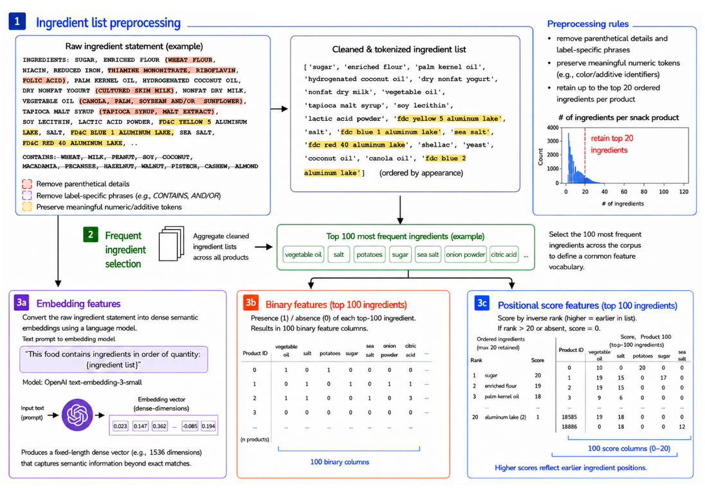

# nutpred

Code for **"Predicting Calcium, Dietary Fiber, and Iron Content in Branded Snack Foods Using Hybrid Ingredient Representations and Knowledge-Guided Features"** (Seoyun Jang, 2026).

nutpred predicts the **calcium, dietary fiber and iron** content of packaged foods from information already on the label: the macronutrient panel and the ingredient list.



## Overview

Features are built from:

- the eight base panel nutrients (`nut8`);
- ingredient features from the ingredient list: binary presence (`binary`), positional score (`score`) and dimension-reduced text embeddings (`umap_20`);
- optional knowledge-guided features from a constrained ingredient-ratio optimization (CVXPY/OSQP) using USDA SR Legacy reference profiles.

Models are XGBoost regressors, optionally as a two-stage **hurdle model** (a zero/non-zero classifier, then a regressor for non-zero values), tuned with Optuna.

## Installation

```bash
git clone https://github.com/sarahjang15/nutpred-paper.git
cd nutpred-paper
pip install -r nutpred/requirements.txt      # Python 3.11; exact versions used in the paper
```

## Data

No food data is distributed. The analysis uses the USDA FoodData Central **Branded Foods** database (April 2025 release), **SR Legacy** (April 2018) and the USDA **Ingredient Thesaurus**, all publicly available from <https://fdc.nal.usda.gov/download-datasets/>.

`run.py` takes three inputs: the food table (`--food-df`), the ingredient thesaurus (`--thesaurus-df`) and the ingredient-nutrient reference table (`--ingnut-df`). Their required columns are described in [`data/README.md`](data/README.md). A small synthetic example of each is provided in `data/example/`.

## Quick start

```bash
python data/make_example_data.py             # synthetic example inputs
python run.py --smoke-test-rows 200 --hurdle --n-trials 5   # quick end-to-end check
```

## Reproducing the paper

```bash
# 1. Ingredient embeddings (UMAP-20, fit on training rows; needs an OpenAI API key)
python -m nutpred.build_ingredient_features --embed \
  --in-csv snacks.csv --api-key-file ~/openai_key.txt --out-csv snacks_umap20.csv

# 2. (Optional) knowledge-guided auxiliary features
python -m nutpred.build_knowledge_guided_features \
  --food-df snacks_umap20.csv --thesaurus-df thesaurus.xlsx \
  --ingnut-df ingnut_top100.csv --out-csv snacks_umap20_kg.csv

# 3. Train and evaluate the hurdle model
python run.py --food-df snacks_umap20.csv \
  --thesaurus-df thesaurus.xlsx --ingnut-df ingnut_top100.csv \
  --hurdle --ing-feature "binary+score+umap_20" \
  --n-trials 100 --n-jobs 16 --shap
```

Defaults match the paper: an 80/20 split with seed 42, 100 Optuna trials per stage, and a Stage 1 threshold chosen on the training set. Run `python run.py --help` for all options.

## Repository structure

```
run.py                                  main pipeline: features → training → evaluation → plots
nutpred/
  build_ingredient_features.py          CLI: binary / score / embedding features
  build_knowledge_guided_features.py    CLI: ingredient-ratio optimization features
  preprocess.py, cleaning.py            ingredient parsing and thesaurus mapping
  split.py                              train/test split
  predict.py                            Optuna-tuned models (single-stage and hurdle)
  metrics.py                            R², W20 and label-tolerance criteria
  prepare.py                            FoodData Central processing and embeddings
  viz.py                                plots and SHAP analysis
data/                                   input schema and synthetic examples
docs/                                   ingredient-feature diagram, data provenance
tests/                                  unit tests (pytest)
```

## Outputs

Each run writes test-set metrics (`metrics_*.csv`), per-product predictions (`df_with_preds_*.csv`), the run configuration and plots (model comparison, scatterplots, SHAP) to the output directory (`--outdir`).

## Citation

To be added.

## License

To be added.

## Contact

Seoyun Jang (syjang115@snu.ac.kr) or open an issue on this repository.
